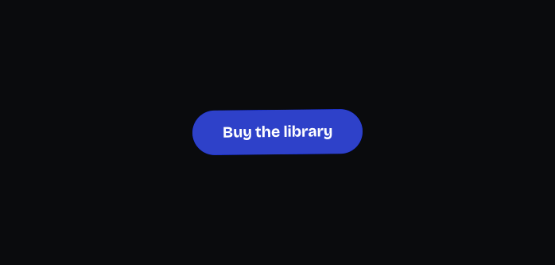
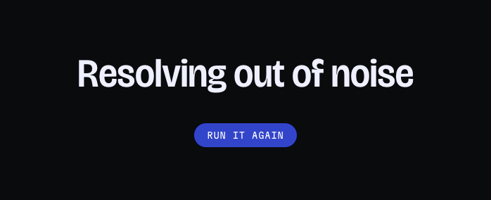
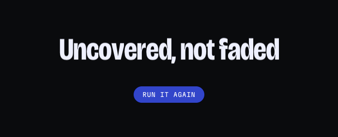
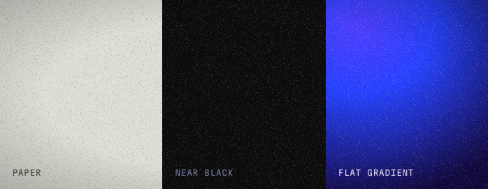

# unbland: free effects

Four small effects for the web, free to use on your own and your clients' sites.
One file each. No build step, no framework, no dependencies.

Install one by dropping its folder into your project and telling your AI
assistant:

> Install this Unbland effect in my project.

Each folder carries instructions written for Claude Code, Cursor and similar
assistants. Prefer to do it by hand? It is one script tag, and the folder's
README has the line to paste.

| Effect | What it does | Size (gzipped) |
|---|---|---|
| [Leaf Spring](leaf-spring/) | A button with mass. It leans toward the pointer, sinks when pressed and overshoots on release. | 4.6 KB |
| [Glyph Static](glyph-static/) | Text that resolves out of noise, one character at a time. | 4.8 KB |
| [Shutter Type](shutter-type/) | Letters slide out from under their own clipped edge. | 4.2 KB |
| [Silver Halide](silver-halide/) | Film grain, a vignette and a colour cast over a page or section. | 5.0 KB |

## Leaf Spring

[Try it live](https://unbland.dev/effects/leaf-spring/) · [Open on CodePen](https://codepen.io/pqivuaul-the-scripter/pen/XJMoRXy) · [Read more](leaf-spring/)

## Glyph Static

[Try it live](https://unbland.dev/effects/glyph-static/) · [Open on CodePen](https://codepen.io/pqivuaul-the-scripter/pen/EaWGmPr) · [Read more](glyph-static/)

## Shutter Type

[Try it live](https://unbland.dev/effects/shutter-type/) · [Open on CodePen](https://codepen.io/pqivuaul-the-scripter/pen/JoWwNGq) · [Read more](shutter-type/)

## Silver Halide

[Try it live](https://unbland.dev/effects/silver-halide/) · [Open on CodePen](https://codepen.io/pqivuaul-the-scripter/pen/LEWMyGw) · [Read more](silver-halide/)

## Licence

Free for any number of projects, commercial and client work included. Change the
code as much as you like and keep the credit comment at the top of the source.
Please do not sell these or republish them as your own effect, template, theme or
component library. This is a free licence with those conditions, not an open
source one. The full terms are in [LICENSE.txt](LICENSE.txt).

## More

These four are the free part of [unbland](https://unbland.dev). The paid effects
go further: real wave simulation, physics and 3D galleries, each with its size,
frame time, memory use and off-screen behaviour measured and printed on its page.

Found a problem? Open an issue or write to hello@unbland.dev.
